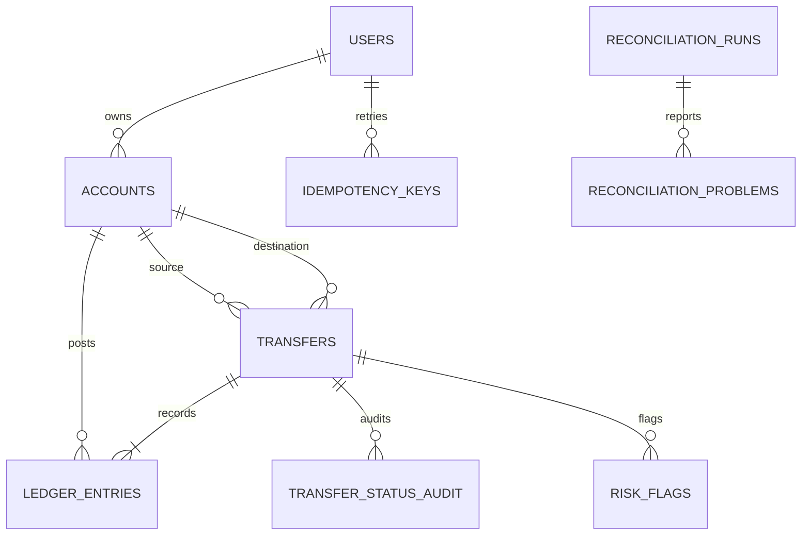

# Schema design

## Noun inventory

| Noun | Table? | Reason |
|---|---|---|
| User | `users` | Identity/contact/KYC data; users own many wallets. |
| Wallet / account | `accounts` | Wallets and system accounts share ledger semantics and balance rules. `account_type` distinguishes them. |
| System account | `accounts` | Cash-in, cash-out and fee revenue are accounts with no user owner. |
| Transfer | `transfers` | Business event, status, amount, type, reversal pointer and timestamps. |
| Ledger entry | `ledger_entries` | Immutable debit/credit line attached to one transfer and one account. |
| Idempotency key | `idempotency_keys` | Stores request hash and first response per user/key. |
| Transfer status audit | `transfer_status_audit` | Records each status transition and actor/time/reason. |
| Risk rule | `risk_rules` | Thresholds and action are data, not hard-coded policy. |
| Risk flag | `risk_flags` | Rule-level fraud flag and optional explanation/label. |
| Reconciliation run/problem | `reconciliation_runs`, `reconciliation_problems` | One run plus each mismatch found. |
| Job lock | `job_locks` | Coordinates one reconciliation runner. |

## Cardinality

- `users` 1:M `accounts` for wallet accounts; system accounts have `user_id NULL`.
- `accounts` 1:M `ledger_entries` and `transfers` (as source/destination).
- `transfers` 1:M `ledger_entries`; a transfer has two or more lines in the intended model.
- `transfers` 1:M `transfer_status_audit` and `risk_flags`.
- `transfers` 0:1 original transfer relationship for reversals (`original_transfer_id`).
- `users` 1:M `idempotency_keys` with unique `(user_id, idempotency_key)`.
- `reconciliation_runs` 1:M `reconciliation_problems`.

## ER diagram

## Money and constraints

Money is a `BIGINT` count of paise; no floating point values are used. Each ledger entry stores a positive amount and a separate `DEBIT`/`CREDIT` direction. Wallet and system accounts use one table so ledger joins and balance logic are uniform; system accounts may go negative, while a database check prohibits negative stored wallet balances. Ledger rows have a trigger rejecting UPDATE/DELETE. Reversals should be represented by a new transfer with opposite entries, not mutation.

Balances are stored and reconciled against ledger-derived balances. This makes balance reads O(1) at the cost of updating the account row on every transfer and requiring careful transactional locking. Email and phone are external user-controlled values, mutable and not guaranteed to remain stable, so they are unique alternate keys rather than primary keys.

## Indexes

The schema indexes account statements by `(account_id, created_at DESC, id DESC)`, transfer history by source/destination and timestamp, ledger entries by transfer, and audit/problem lookup keys. Indexes improve reads but increase write amplification and storage. Reconciliation queries intentionally scan/aggregate ledger data nightly; inspect `EXPLAIN ANALYZE` on production-scale data before adding further indexes.

## Important implementation note

PostgreSQL cannot enforce cross-row equality of debit and credit sums with a normal CHECK constraint. The service inserts transfer + entries + balance updates in one transaction, and the reconciliation job detects any mismatch. For a hardened production deployment, add a deferred constraint trigger that validates each completed transfer at commit.
